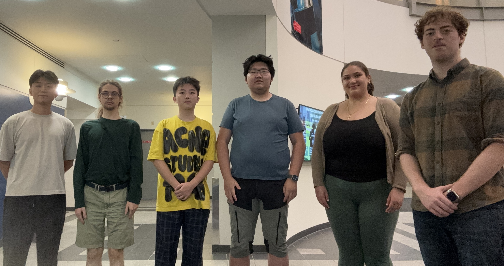

# 02-Team 20 Repo

<p align="center">

</p>
<p align="center">
</p>

## Team links
- [Team Google Drive](https://drive.google.com/drive/folders/18hj7UzWaYRHKyD4bCQZlHjeqAHzE-pgK?usp=sharing)
- [Team Board]()

## Python setup (laptop)

The laptop code (`vision/aruco/`, `pipeline/`, `dstar_lite_planner.py`) needs **Python 3.10 or newer**, plus the packages in [`requirements.txt`](requirements.txt): OpenCV, numpy and reportlab. `laptop/robot_client.py` uses only the standard library. The robot firmware is set up separately (see [`robot/README.md`](robot/README.md)).

Check your version with `python3 --version`. macOS's built-in `python3` is 3.9, which is too old: install a newer one from [python.org](https://www.python.org/downloads/) or with `brew install python`, then use that one (e.g. `python3.12 -m venv .venv`) in the first step below.

Make a virtual environment (venv) once, from the repo root. It keeps these packages separate from the rest of your computer:

**macOS / Linux**
```bash
python3 -m venv .venv
```
```bash
source .venv/bin/activate
```
```bash
pip install -r requirements.txt
```

**Windows (PowerShell)**
```powershell
py -m venv .venv
.venv\Scripts\Activate.ps1
pip install -r requirements.txt
```

- **Each new terminal:** run `source .venv/bin/activate` again (Windows: `.venv\Scripts\Activate.ps1`). The prompt shows `(.venv)` while it's active, and `deactivate` leaves it.
- **Check it worked:** `python -c "import cv2; print(cv2.__version__, hasattr(cv2.aruco, 'ArucoDetector'))"` should print a version of 4.7 or later and `True`.
- **Run the tools with the venv active**, e.g. `python pipeline/go_to_point.py --source 1`. Inside the venv, `python` and `python3` are the same.
- **Conda users:** run `conda deactivate` first, so the venv is built from a plain Python, not mixed with conda's packages.
- **Package changes:** if someone adds a package, add it to `requirements.txt` and everyone reruns `pip install -r requirements.txt`.
- **macOS camera:** the first time a script opens the camera, macOS asks to give your terminal (or VS Code) camera access. Allow it, then restart the terminal.
- The `.venv/` folder is gitignored. Don't commit it; each person makes their own.

## Organization of this repo

This depends on your set of roles. Try these queries to set up
your initial repo. You can always change this later.

- "What is a good organization of a repo for a team of two electrical engineers, two computer engineers, and one mechanical engineer? The team is undertaking the design and build of an embedded system and mechanicals for and electronic cat feeder project"


As in your individual repo, you can customize your based on your preferred tools (e.g., CAD
software, IDE, etc.)

Example:

```
├── hardware/                  # Electrical Engineering (EE)
│   ├── schematics/            # Circuit diagrams, block diagrams, design files
│   ├── pcb/                   # PCB layout, Gerber files, drill files
│   ├── bom/                   # Bill of Materials (components, suppliers, costs)
│   └── simulation/            # SPICE simulations, power budget models
│
├── firmware/                  # Computer Engineering (CE/Software)
│   ├── src/                   # Source code (.c, .cpp, etc.)
│   ├── include/               # Header files (.h, .hpp)
│   ├── lib/                   # External libraries and vendor drivers
│   ├── tests/                 # Unit tests, integration tests
│   └── build/                 # Build output / configuration files (PlatformIO/CMake)
│
├── mechanical/                # Mechanical Engineering (ME)
│   ├── cad/                   # 3D models (STEP, SLDPRT, Fusion 360 archives)
│   ├── drawings/              # 2D technical drawings, dimensioned PDFs
│   ├── 3d_print/              # STL/3MF files for fast prototyping
│   └── renders/               # Product renders and enclosure mockups
│
├── docs/                      # Shared Project Documentation
│   ├── architecture/          # Pinout tables, system wiring, block diagrams
│   └── datasheets/            # Component PDFs (ICs, sensors, motors)
│
├── scripts/                   # Shared Automation & Utilities
│   ├── flashing/              # Flash/programming scripts
│   └── tests/                 # Hardware-in-the-loop / test automation scripts
│
├── .gitignore                 # Ignore generated files (binaries, Gerber zips, CAD locks)
└── README.md                  # Project overview, setup guides, and team roles
```

